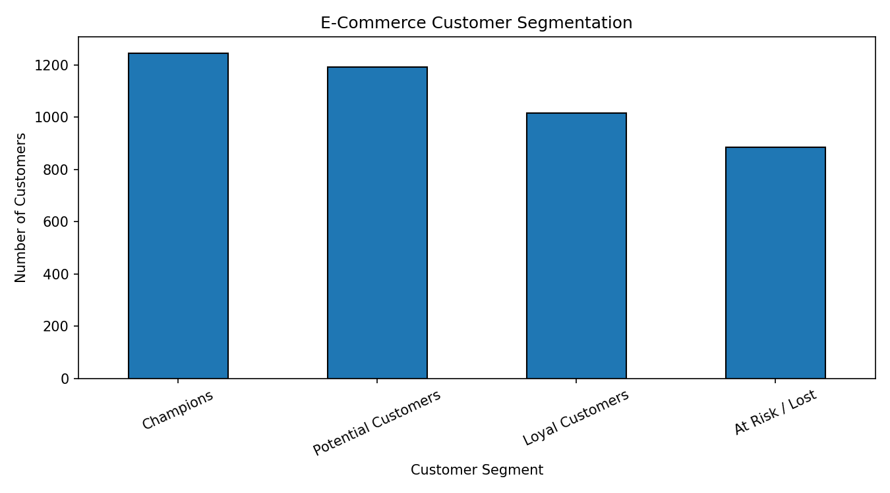
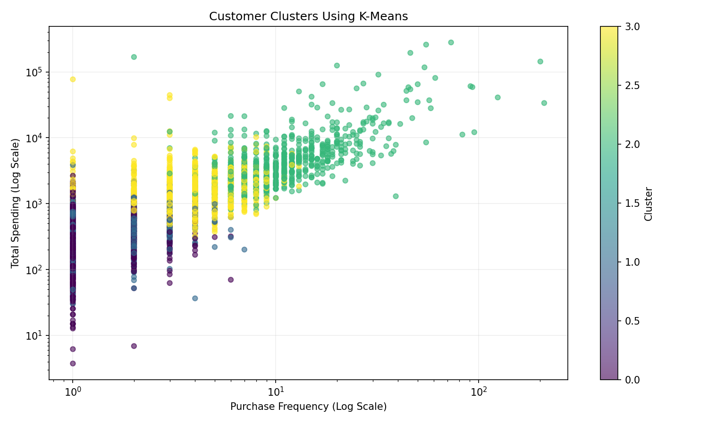

# E-Commerce Customer Segmentation Using RFM Analysis

## Project Overview

This project focuses on analysing e-commerce customer purchasing behaviour using RFM (Recency, Frequency and Monetary) analysis and K-Means clustering.

The main objective is to group customers based on their purchasing patterns and understand how businesses can use this information to improve their marketing strategies.

## Project Objectives

- Analyse customer purchasing behaviour.
- Calculate Recency, Frequency and Monetary values.
- Assign RFM scores to customers.
- Identify different customer segments.
- Apply K-Means clustering to group similar customers.
- Suggest marketing strategies for different customer groups.

## Dataset Information

**Dataset:** Online Retail Dataset  
**Source:** UCI Machine Learning Repository

The dataset contains online retail transaction information, including product descriptions, quantities, invoice dates, unit prices, customer IDs and countries.

After data cleaning, the analysis included **4,338 customers**.

## Technologies Used

- Python
- Pandas
- NumPy
- Matplotlib
- Scikit-learn
- Google Colab

## Project Methodology

### 1. Data Cleaning

- Removed records with missing Customer IDs.
- Removed transactions with invalid quantities and prices.
- Converted invoice dates into datetime format.
- Calculated the total transaction amount.

### 2. RFM Analysis

RFM analysis was performed using three values:

- **Recency:** Number of days since the customer's last purchase.
- **Frequency:** Number of distinct transaction timestamps, used as a purchase-frequency proxy.
- **Monetary:** Total amount spent by the customer.

### 3. Customer Scoring

Customers were assigned scores from 1 to 5 for each RFM value. The combined scores were used to classify customers into four segments.

### 4. Customer Segmentation

Customers were divided into four groups:

- Champions
- Loyal Customers
- Potential Customers
- At Risk / Lost

### 5. K-Means Clustering

K-Means clustering was applied using Recency, Frequency and Monetary values.

The data was log-transformed and standardized before applying the algorithm. Four clusters were created.

## RFM Customer Segmentation Results

**Total Customers Analysed: 4,338**

| Customer Segment | Number of Customers |
|---|---:|
| Champions | 1,245 |
| Potential Customers | 1,192 |
| Loyal Customers | 1,016 |
| At Risk / Lost | 885 |
| **Total** | **4,338** |

## K-Means Clustering Results

| Cluster | Number of Customers |
|---|---:|
| Cluster 0 | 1,608 |
| Cluster 1 | 842 |
| Cluster 2 | 711 |
| Cluster 3 | 1,177 |
| **Total** | **4,338** |

Cluster 2 contains customers with the highest average purchasing frequency and monetary value.

Cluster 0 represents customers with lower purchasing activity and higher average recency.

## Business Recommendations

- **Champions:** Provide loyalty rewards, exclusive offers and early access to products.
- **Loyal Customers:** Encourage repeat purchases through membership benefits.
- **Potential Customers:** Use personalised offers and product recommendations.
- **At Risk / Lost:** Introduce win-back campaigns and special discounts.

## Visualizations

### Customer Segmentation

### K-Means Customer Clustering

## Project Files

- `Ecommerce_Customer_Segmentation.ipynb` – Google Colab notebook containing the Python code and analysis.
- `customer_rfm_segments.csv` – Customer RFM scores, segments and cluster information.
- `segment_summary.csv` – Summary of customer segments.
- `cluster_summary.csv` – Summary of K-Means clusters.
- `customer_segments.png` – Customer segmentation visualization.
- `customer_clusters.png` – K-Means clustering visualization.

## Conclusion

This project helped me understand how customer purchasing behaviour can be analysed using RFM analysis and K-Means clustering.

The analysis identified four customer segments and four additional clusters based on purchasing similarities.

These results can help businesses understand their customers and plan suitable marketing strategies.

## Limitations

The imported dataset did not include the InvoiceNo column. Therefore, Frequency was calculated using distinct invoice timestamps as a proxy instead of distinct invoice numbers. This may affect the accuracy of purchase-frequency measurements.

The customer segment thresholds and number of K-Means clusters were selected for this project and may require further validation for real business use.

## Author

Rabia
